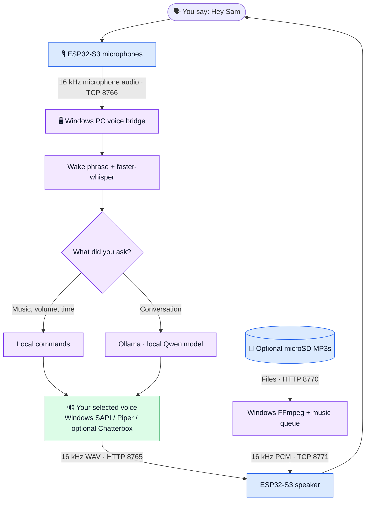

# SAM — Hands-Free Local AI Voice Assistant

**Build a hands-free AI smart speaker with the Waveshare ESP32-S3-AUDIO-Board and a Windows PC.** SAM listens for a wake phrase, processes speech locally and speaks back using **a voice chosen by the user**. It is not tied to a particular voice or gender. No Home Assistant account or cloud LLM subscription is required for the baseline setup.

> **Project status:** Early community release / hardware-tested prototype. The original v4 standard-I²S microphone path and the v5 Windows speech pipeline have worked on one physical Waveshare board. Installation, microSD music and optional voice-model features may need adjustment on other PCs. This is **not** a turnkey commercial product.

## Meet the hardware

  

Correct upright orientation: translucent circuit-board cover and microphones on top; black speaker housing below. Image: <a href="https://www.waveshare.com/product/mcu-tools/development-boards/esp32-s3-audio-board.htm">Waveshare official product photo</a>.

The board combines dual microphones, speaker output, a programmable RGB light ring and microSD storage. A Windows PC performs speech recognition, AI and voice synthesis. See the [Waveshare board reference](https://docs.waveshare.com/ESP32-S3-AUDIO-Board) for additional photos and the exposed PCB.

## How SAM works

**In plain language:** your voice travels from the ESP32 to the Windows PC over your private Wi-Fi network. The PC recognizes the request, handles it with a local command or local AI model, synthesizes speech with **your chosen voice**, and sends the audio back to the device. See [the full architecture](docs/ARCHITECTURE.md).

## What SAM can do

- **Hands-free listening:** say *“Hey Sam”*; an optional K2 diagnostic button remains.
- **Follow-up conversation:** remember recent turns and listen for another question during a short follow-up window after a reply.
- **Local speech recognition:** [faster-whisper](https://github.com/SYSTRAN/faster-whisper) transcribes microphone audio on the Windows PC.
- **Local AI conversation:** [Ollama](https://ollama.com/) runs a Qwen-based model on the PC.
- **Choose your voice:** select an available Windows SAPI voice, an optional [Piper](https://github.com/rhasspy/piper) model, or a custom voice through the experimental Chatterbox path (with consent).
- **Music from microSD:** index MP3 files, decode with FFmpeg on Windows, and stream playback to the speaker.
- **Voice music controls:** play, shuffle, skip, pause, resume and stop.
- **Voice volume controls:** *“volume up”*, *“volume down”*, *“set volume to 40 percent”*, *“mute”* and *“unmute”*.

## Choose SAM's voice

**The voice is your choice.** SAM does not require any particular voice model, and a cloned voice is optional.

1. Start with an installed Windows SAPI voice, or install one of the supported optional voice engines.
2. Run **`CHOOSE_SAM_VOICE.bat`** to select an available voice or configure an optional model.
3. For advanced custom voice synthesis, see [voice setup and optional cloning](docs/VOICES.md). Only synthesize a person's voice when you have permission.

The exact voices available depend on your Windows installation and the models you install.

## Start here

**You'll need:** a Waveshare ESP32-S3-AUDIO-Board, compatible speaker, and Windows 10/11 PC on the same trusted 2.4 GHz Wi-Fi network. A FAT32 microSD card is optional for music.

1. Read **[First-time installation](docs/INSTALL.md)** before flashing. The included working-v5 upgrade installer can recover configuration from an older SAM installation; first-time setup requires the prerequisites and local configuration explained there.
2. Install [Ollama](https://ollama.com/), run `ollama pull qwen3.5:4b`, and keep Ollama running.
3. Use the provided Windows scripts to configure and flash the ESP32. After the first flash, run **`START_SAM.bat`** to start the bridge without reflashing.
4. Select your preferred voice using **`CHOOSE_SAM_VOICE.bat`**.
5. Say **“Hey Sam”** and ask a question. During the follow-up window, you can ask another question without repeating the wake phrase.

### Example voice commands

| Say | Expected action |
| --- | --- |
| “Hey Sam, what time is it?” | Read the Windows PC clock |
| “Hey Sam, tell me a joke.” | Ask the local Ollama model |
| “And another one.” | Continue the conversation during the ~12-second follow-up window |
| “Hey Sam, play some music.” | Shuffle the microSD music library |
| “Hey Sam, play Queen.” | Search the MP3 filenames for artist/title |
| “Next song.” / “Pause music.” | Control music playback |
| “Set volume to 40 percent.” | Set speaker volume |

## Documentation

- [Installation and setup](docs/INSTALL.md)
- [Board pins and microSD](docs/HARDWARE.md)
- [Audio and AI workflow](docs/ARCHITECTURE.md)
- [Music playback](docs/MUSIC.md)
- [Choosing your voice and optional cloning](docs/VOICES.md)
- [Troubleshooting](docs/TROUBLESHOOTING.md)
- [Roadmap](docs/ROADMAP.md)
- [Security and voice consent](SECURITY.md)

## Privacy and important warnings

SAM's baseline recognition, reasoning and speech synthesis run locally **after required model downloads**, but its LAN audio/control streams are **not encrypted**. Use only on a trusted private network; do not expose ports to the Internet. The Windows PC must remain powered on for normal operation.

Never commit **`sam_config.h`**, **`windows/settings.json`**, Wi-Fi passwords, shared tokens, voice recordings, virtual environments or neural model weights. They are excluded from this public release.

## License and credits

Licensed under the existing [GNU GPL v3](LICENSE). SAM builds on work from ESPHome, Espressif, Arduino, Whisper, Ollama, Piper, FFmpeg and Chatterbox; their software, model files and licenses remain with their respective authors. SAM is an independent community project, not an official Waveshare, OpenAI, Ollama or ESPHome product.
